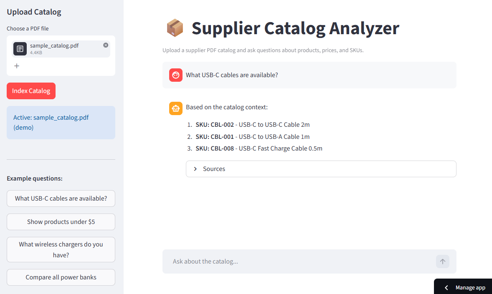

# Supplier Catalog Analyzer

A RAG-based tool for querying supplier PDF catalogs using natural language. Upload a product catalog and ask questions about products, prices, SKUs, and availability.

  



**[Live Demo](https://supplier-catalog-analyzer.streamlit.app)**

## Features

- **PDF ingestion** — extracts both tables and plain text from supplier catalogs
- **Smart chunking** — each product row becomes a separate chunk with SKU, price, and category metadata
- **Natural language Q&A** — ask questions in plain English, get structured answers with sources
- **Multi-provider LLM** — switch between Claude (Anthropic), Gemini (Google), or Ollama (local)
- **Source attribution** — every answer shows which page and SKU it came from

## Tech Stack

- **LangChain** — RAG pipeline and LLM abstraction
- **ChromaDB** — vector store for semantic search
- **pdfplumber** — PDF parsing with table extraction
- **Streamlit** — web UI
- **Claude / Gemini / Groq / Ollama** — LLM backends

## Getting Started

### 1. Clone the repo

```bash
git clone https://github.com/your-username/supplier-catalog-analyzer
cd supplier-catalog-analyzer
```

### 2. Install dependencies

```bash
python -m venv venv
source venv/bin/activate  # Windows: venv\Scripts\activate
pip install -r requirements.txt
```

### 3. Configure environment

Copy `.env.example` to `.env` and fill in your credentials:

```bash
cp .env.example .env
```

### 4. Run

```bash
streamlit run app.py
```

Open [http://localhost:8501](http://localhost:8501), upload a PDF catalog, and start asking questions.

## Configuration

| Variable | Description | Default |
|----------|-------------|---------|
| `LLM_PROVIDER` | `anthropic`, `gemini`, or `ollama` | `anthropic` |
| `ANTHROPIC_API_KEY` | Anthropic API key | — |
| `ANTHROPIC_MODEL` | Claude model name | `claude-haiku-4-5-20251001` |
| `GOOGLE_API_KEY` | Google AI Studio API key | — |
| `GEMINI_MODEL` | Gemini model name | `gemini-2.0-flash` |
| `GROQ_MODEL` | Groq model name | `llama-3.1-8b-instant` |
| `OLLAMA_MODEL` | Local Ollama model | `llama3.2` |

## Project Structure

```
supplier-catalog-analyzer/
├── app.py                 # Streamlit UI
├── catalog_processor.py   # PDF parsing and chunking
├── rag_chain.py           # LangChain RAG pipeline
├── estimate_tokens.py     # Estimate tokens usage
├── requirements.txt
├── .env.example
├── sample_catalog.pdf     # Sample catalog for testing
└── README.md
```

## How It Works

1. **Ingest** — pdfplumber extracts tables and text from the PDF
2. **Chunk** — each product row becomes one chunk with metadata (SKU, price, category)
3. **Embed** — chunks are embedded and stored in ChromaDB
4. **Retrieve** — user question is embedded, top-5 similar chunks are retrieved
5. **Generate** — retrieved context + question are sent to the LLM

The key differentiator from generic document Q&A is **product-level chunking**: instead of splitting by character count, each product is a self-contained chunk with structured metadata — enabling both semantic search and metadata filtering.

## Sample Catalog

A sample electronics wholesale catalog (`sample_catalog.pdf`) is included for testing. It contains 22 products across 3 categories: cables, chargers, and audio accessories.

## License

MIT

## Contact
Built by Vamshi V [LinkedIn](https://www.linkedin.com/in/vamshi-v-bba465297/?isSelfProfile=true)
